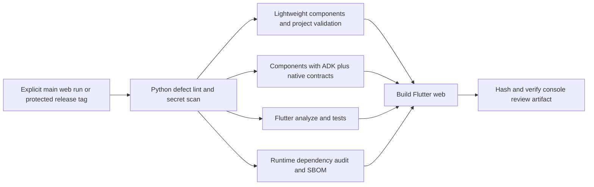
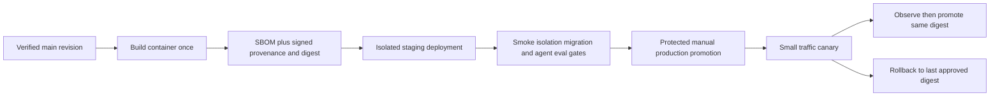

# Lightning delivery process

Design baseline: 2026-09-05; pipeline policy reviewed 2026-09-20. See
[SDK CI and releases](sdk-releases.md) for researched practices and the implemented
protected-tag publication process. Owner roles below need named
assignees in GitLab. This process supports the product direction in
[the competitive plan](../COMPETITIVE_PRODUCT_PLAN.md): an ADK-native authoring,
evaluation, and release platform for customer-facing agents.

## Current pipeline policy

Ordinary branch pushes, merge requests and scheduled runs **do not create
pipelines**, by owner choice while the origin's shell runners lack the required
container toolchains. Run the relevant locked local checks and record evidence
in the MR; a missing pipeline is not a passing CI or security scan.

To run the full verification pipeline explicitly, use GitLab **Build → Pipelines
→ New pipeline** on `main` (pipeline source `web`). No variable override is
needed. Protected version-tag pushes still run all release gates and may publish
only after they pass. No jobs are changed to `allow_failure`, and runner or branch
protection settings are not modified by this policy. Repair runner selection
before expecting these opt-in jobs to execute successfully.

The workflow rules are version-controlled in `.gitlab-ci.yml`; revert that
policy change to restore automatic push/MR/schedule pipelines. The controls and
production process below describe the intended fully gated delivery baseline,
not evidence that every current MR has remote checks.

## Community verification configuration

The private-origin policy above remains unchanged. For a separately provisioned
community project, [`.gitlab/ci/community.yml`](../.gitlab/ci/community.yml) enables
contribution verification using the same locked jobs, rejects parent-project runs
of cross-project MRs, and disables publication. See the
[activation and trust-boundary checklist](community-release.md#community-ci-candidate).
Selecting that file does not provision safe runners, restrict job-token access or
enforce successful merges; administrators must verify those controls separately.

## Decision and boundaries

The fully gated target uses GitLab as the delivery control plane, short-lived
branches into protected `main`, locked dependencies, mandatory automatic checks,
and immutable artifacts. Current pipeline admission is the opt-in policy above.
Keep routine contributor checks independent of customer credentials and private
external application packages. Add hosted delivery when the platform can safely host workloads.

There are two independently versioned products:

1. **Platform:** Python runtime/API, Flutter console, schemas, and migrations.
2. **Agent release:** configuration, prompts, skill bodies/references, tool
   bindings and schemas, retrieval index/source revisions, policy, model/provider
   settings, and evaluation cases. Editing a prompt can change behavior as much
   as editing Python; an agent release needs its own evidence and rollback.

Today the pipeline produces a **console review artifact**, a separate console ZIP and a slim
SDK wheel verified through project creation and bundle execution. These are not
a certified agent release. `adkl.server` uses a development HTTP
server and process-global state; shared production hosting, tenant isolation,
identity enforcement, calibrated retrieval tuning and generated-code export parity remain
product work. No fake deploy job, public preview, or production credentials are
introduced by this change.

## Static portal container candidate

The [read-only multi-agent portal](static-portal.md) is a separate static-site
build, not production hosting of `adkl.server`. `scripts/build_portal.sh` prepares
reviewed offline snapshots and the dedicated Flutter UI, verifies its manifest,
and emits a non-root Nginx container context. The `static-portal-review-build`
job builds that context with an empty/unavailable-agent example registry, not
customer content. It does not build, scan, publish or deploy a container image.
An approved immutable Nginx base, authenticated gateway/private origin, audience
isolation, image scanning, staging and rollback evidence remain operator gates.
The runtime/agent-execution entry criteria below still apply if live execution
is introduced; the static portal introduces no live agent transport.

## Connected portal review build

`connected-portal-review-build` compiles the separate read-only connected Flutter
entry point and verifies a dedicated web manifest after required test gates.
Artifacts contain no host data or credentials. The gateway is packaged in the
SDK wheel; no gateway image, SSO, private ingress or deployment is created.
See [connected inspection](connected-inspection.md) for boundaries and retained
verification receipt configuration. This is not a shared developer server.

## Delivery principles

Use locked dependencies, required deterministic checks and immutable artifact
identity. Keep model credentials and application infrastructure out of ordinary
merge-request jobs. A console build is review evidence; production deployment
requires the entry criteria below.

## Implemented pipeline



Within an admitted pipeline, all jobs are required and automatic. Stage ordering
holds the build until every check succeeds; there is no DAG shortcut around security or tests. Infrastructure
failures may retry once; assertion failures do not. Jobs have a 20-minute timeout
and are interruptible. GitLab project settings must still require a successful
pipeline before merge; YAML alone cannot enforce that setting.

| Job | What it establishes | Limits |
|---|---|---|
| `python-lint` | Syntax/undefined-name defects using locked Ruff, release metadata and local documentation targets | No semantic prose validation, external-link checks or whole-repo formatter/type-check claim |
| `secret-scan` | Redacted Gitleaks scan of checkout | Not a full historical scan; no replacement for credential rotation |
| `components` | Lightweight tests, agent schemas, skill and structural widget lint; JUnit | Existing warnings are visible but not fatal; external hook checks remain incomplete |
| `native-adk-contract` | Same component suite with runtime dependencies plus required real ADK skill/tool/resource contracts; JUnit | No model calls; absent external host integration can skip |
| `console` | Locked Flutter dependencies, analyzer, widget tests | No browser end-to-end or accessibility certification |
| `dependency-audit` | Public platform runtime advisories and CycloneDX 1.5 dependency SBOM from its lock | No Dart, OS/container, or CI-tool vulnerability coverage yet; fails on service errors too |
| `console-review-build` | Compiles release-mode web assets, records SHA-256 inventory, verifies exact file set | Unsigned review evidence; not a production release or SLSA attestation |
| `sdk-onboarding` | Builds a slim SDK wheel and separate console ZIP, verifies an independent project bundle and native turn, then executes staged A2UI v0.9/v1.0 from a separately installed native example | Synthetic models; does not build/run the Docker image or certify a production host |

Workflow rules admit only explicit default-branch web runs and protected
`vX.Y.Z` / `vX.Y.Z-rc.N` tag pushes. Branch pushes, MRs, schedules, other tags
and trigger sources do not create a pipeline. Protected tags run the same
checks/build, then publish verified SDK files and
GitLab release links through the isolated `sdk-publish` job.
Create schedules in GitLab explicitly; this repository does not create them.

Python 3.13 / uv 0.10.10 / Flutter 3.44.0 and scanner versions are explicit.
All three images use verified Linux/amd64 manifest digests; provision amd64
runners. Updating a tag label alone does not update the pinned image.
Python download caches are keyed by lock plus toolchain; Flutter caches by lock
plus SDK. Virtualenvs and compiled outputs are not reused as dependency caches.
Keep GitLab's separation of protected and unprotected caches enabled. Review and
refresh image digests in dependency MRs to pick up toolchain/security updates.

The console manifest records commit, dirty-tree status, lock/pipeline hashes,
file hashes and `productionReady: false`. A local manifest identifies its parent
commit and records local dirtiness; it must not be described as a clean CI build.
Verification detects changed, missing, added and symlinked assets. It does not
provide authenticity if someone can replace both the artifact and manifest.
Job reports expire after 7–14 days; tagged SDK releases retain manifests,
tested-lock SBOMs and advisory reports in the GitLab package registry.

## Adopt in GitLab: fully gated target

Restore automatic MR/schedule pipeline admission and repair runners before
following the MR and daily-schedule steps below. Under the current opt-in policy,
creating a schedule alone does not execute checks.

These are administrative control requirements. SDK release setup now configures
available GitLab controls; named reviewers, tier-dependent approval enforcement
and adversarial drills must not be inferred from YAML alone.

1. Assign a platform maintainer and a second reviewer. Provision Linux/amd64 runners
   able to pull the three documented images and reach public package/advisory
   endpoints. Use disposable jobs, no host Docker socket, and no production
   credentials on MR runners. Validate this YAML with the project's CI Lint and
   run a real MR pipeline before enabling the merge gate.
2. Protect `main`: no direct developer pushes, no force-push; merges through MRs.
   Require successful pipelines and resolved discussions. Require one independent
   review, two for identity, tenancy, tools with side effects, or delivery control.
   Enforce approvals/CODEOWNERS and merged-result pipelines where the GitLab tier
   supports them. On tiers lacking enforcement, name a maintainer as merge owner;
   don't present a template checkbox as technical enforcement.
3. Protect `v*` tags for release maintainers only. Restrict CI configuration,
   dependency locks, skills and release scripts to appropriate review owners;
   add CODEOWNERS after real GitLab usernames/groups are chosen. Restrict pipeline
   variable overrides and job-token permissions. Do not run unreviewed fork code
   in a privileged parent pipeline. No customer model keys in this pipeline.
4. Run Gitleaks and the dependency audit, remediate confirmed findings, and resolve
   runner/tool compatibility. A failed scanner is a failed gate. For a demonstrable
   false positive, use a narrow fingerprint/rule/path exception with owner,
   rationale and expiry in review; do not add broad exclusions or global ignores.
5. Create a daily default-branch schedule to find new advisories on unchanged
   dependencies. Review notifications in GitLab; no messaging automation is
   installed. Handle dependency updates as MRs with lock diffs and native contracts.
6. Exercise one deliberately failing MR and confirm merge is blocked; exercise
   branch-to-MR transition without duplicates, a protected RC tag, an unprotected
   tag, and a cancelled pipeline. Download a console artifact and verify it.

Follow GitLab's [workflow rules](https://docs.gitlab.com/ci/yaml/workflow/) for
source selection and [protected branches](https://docs.gitlab.com/user/project/repository/branches/protected/)
for merge controls. The locked cache/install approach follows
[uv's GitLab guidance](https://docs.astral.sh/uv/guides/integration/gitlab/).

See [environment separation](environments.md) for the implemented local worker
boundary and unavailable remote profiles. Customer runtime jobs must execute on
approved customer-hosted runners with scoped secrets and network policy; they
are not enabled by adding a target name to configuration.

## Production delivery target



Start with one managed deployment target, preferably GCP Cloud Run if the team
chooses GCP alongside ADK, behind managed identity and a production API service.
Confirm region, tenancy, data retention and customer network needs before
provisioning. Keep exported customer agents separate from the control plane.
Avoid a Kubernetes/platform abstraction project before operational needs justify
it. Cloud Run is a proposed target here; no cloud resources have been created.

**Entry criteria:** production API with authentication/authorization, tenant-scoped
storage and sessions, persisted versioned configuration, complete runtime factory
shared by preview/export, secret references, health/readiness endpoints, audit
logging/redaction, real integration tests, and observable error/latency metrics.
A declaration or UI toggle cannot satisfy one of these criteria.

Then implement:

- Build one non-root image with a pinned base digest from the tested revision;
  lock dependencies and remove build tools from runtime. Run container and Dart
  dependency scanning; produce complete platform and agent SBOMs. Use build
  secret mounts for private registries and short-lived OIDC/workload identity
  for publishing/deploying. Keep secrets out of image layers, artifacts and logs.
- Store image by immutable digest, sign it and retain provenance containing source,
  builder identity and inputs. Verify signatures at deployment. The current JSON
  manifest is a stepping stone, not a claim to any
  [SLSA build provenance guarantee](https://slsa.dev/spec/v1.2/build-provenance).
- Automatically deploy that digest to isolated staging after main gates. Serialize
  each environment's deployments with `resource_group`, prevent outdated jobs,
  and make promotions non-interruptible. Use protected environments/approvals
  where licensed. These controls follow
  [GitLab deployment safety](https://docs.gitlab.com/ci/environments/deployment_safety/).
- Smoke-test login/authorization, project creation/save/reload, one deterministic
  agent/tool turn, revision consistency and rollback. Exercise tenant-crossing
  denial, repeated mutation/idempotency and secret redaction. Separate flaky live
  model evaluation from deterministic assertions; failure still blocks promotion.
- Promote the **same staging-tested digest**, never rebuild for production. Start
  at 5% traffic for at least 30 minutes and 100 representative requests, then 25%,
  then 100% after stable windows. These are initial proposed policy values, not
  measured capacity. Low-volume pilots need explicit synthetic/supervised traffic
  and a longer observation window rather than automatic success with no samples.
- Stop/rollback on any authorization or data-isolation failure, confirmed unsafe
  mutation, or sustained regression above the agreed error/latency budget.
  Initial proposal: 5xx above 1% or twice baseline, p95 latency above 1.2x baseline
  for 10 minutes with enough samples. Calibrate per workload before enabling.
- Keep the last approved platform digest AND agent release revision. Revert traffic
  without rebuilding; verify smoke checks and metrics after rollback. Use
  expand/contract migrations so the previous binary remains usable; backup/restore
  is the recovery path for irreversible data changes. Drill this before pilots.

## Agent content and evaluation gate

An agent release manifest should include content hashes, runtime/ADK version,
model identifier and provider settings, tool schema/implementation revision,
policy/capability manifest, data/index revisions, eval dataset/grader revision,
results and prior rollback revision. A provider alias is not an immutable model;
record the resolved version when available and rerun behavioral evaluation on
provider changes. Bind results to the candidate's exact inputs.

| Gate | Requirement for a pilot release | Implementation state |
|---|---|---|
| Structural | Parse config/skills, resolve tools/resources, reject unsupported capabilities | Partly implemented; adopted external widget hooks and warnings need release policy |
| Deterministic execution | Load procedure/reference, enforce tool/identity policy, persist correct session state, verify preview/export parity | Native ADK baseline exists; full Lightning parity is pending |
| Behavioral | Positive and near-neighbor routing, multi-turn recovery, grounded answer/action, refusal and handoff cases | Versioned datasets and harness pending |
| Safety | Zero failures in critical authorization/isolation/consent cases | Full runtime enforcement and adversarial suites pending |
| Quality and efficiency | Compare task completion, grounding, tool correctness, p50/p95 latency, token/tool cost against approved baseline | Measure before setting credible thresholds; don't use test counts as product quality |

Keep model evaluation credentials only in a protected, environment-scoped lane
using synthetic/redacted data and sandbox tools. Set spend/time limits, disable
real transactions, retain redacted traces, and repeat nondeterministic cases.
Report sample counts, variance, model/dataset versions and material regressions.
Do not send private customer data to external graders by default. Promote agent
content independently after the same evidence review; the visual builder should
eventually expose these gates and their failures as product functionality.

## Delivery sequence and accountability

| When / effort | Work | Accountable role | Acceptance evidence |
|---|---|---|---|
| Now, repository changes | CI gates, JUnit, SBOM/audit, artifact hashes, development guide/skills | Platform engineer | Local checks and actual GitLab MR pipeline |
| Week 1, 2–3 engineer-days | Runner/project protection setup, scanner triage, image execution, branch/tag matrix | Maintainer + platform engineer | Failed MR cannot merge; trusted/untrusted runs isolated |
| Weeks 2–3, 5–8 engineer-days | Warning policy, hermetic connector fixtures, browser journey tests, broader lint/type-check adoption, Dart/container scan design | Runtime + console engineers | New invalid bindings fail; end-to-end author/save/test path; measured CI timings |
| After production entry criteria, 1–2 engineer-weeks | Production container, IaC, workload identity, staging and smoke tests | Platform + runtime engineers | Recreate staging; deploy by digest; identity/isolation tests pass |
| Following sprint, 1–2 engineer-weeks | Signed promotion, canary/rollback, migration drill, telemetry | Platform + QA/runtime | Same digest promoted; rollback drill under 10 minutes |
| Alongside shared runtime, 1–2 engineer-weeks | Agent release manifests, repeatable eval suites, console evidence view | Runtime + product/QA | Candidate evidence tied to exact revision; bad agent release blocked |

Estimates exclude implementing the product's missing security/runtime capabilities
and depend on cloud/GitLab access. Avoid scheduling production by calendar alone.
Track median/p95 feedback time (initial p95 target under 10 minutes), flaky check
rate (under 1%), change lead time, deployment frequency, change failure rate and
recovery time. Establish a two-week baseline before using improvement targets.

## Local reproduction

See [development.md](development.md) for commands and change-specific evidence.
After building the web console:

```bash
uv run --no-sync python scripts/ci/artifact_manifest.py create console/build/web console/build/manifest.json
uv run --no-sync python scripts/ci/artifact_manifest.py verify console/build/web console/build/manifest.json
```

For a downloaded artifact, run `verify` against its web directory and manifest.
Its integrity is meaningful only relative to a manifest obtained from a trusted
pipeline. Do not upload review artifacts to public hosting as part of validation.

## Historical local verification: initial CI implementation

Recorded 2026-09-05 against the current working tree, including concurrent project
work. Fresh isolated Python environments were used to avoid relying on packages
left in a developer virtualenv:

- Lightweight lane: 295 passed, 9 skipped; project/schema/structural lint completed
  with visible warnings. Runtime-dependent and external-checkout tests can skip.
- Runtime lane: 301 passed, 4 skipped, including the required native ADK contract.
  Remaining skipped tests require the external host checkout/integration setup.
- Ruff defect checks passed. Shell syntax and Git diff whitespace checks passed.
- Gitleaks 8.24.2 checkout scan found no leaks; its downloaded release checksum
  matched. All four workflow skill files passed skill-creator validation.
- Flutter release web build succeeded; 39 artifact files were hashed and verified.
- Pipeline passed the downloaded official GitLab JSON schema. Image availability
  and Linux/amd64 digests were checked against their registries. This does **not**
  substitute for project CI Lint, runner execution or branch protection tests.
- Runtime dependency audit found no known advisories after narrowing dependencies;
  the CycloneDX runtime SBOM was generated. The original broad ADK extensions extra
  pulled NLTK 3.10.3, affected by
  [GHSA-8mgp-746c-j5xp](https://github.com/advisories/GHSA-8mgp-746c-j5xp).
  Lightning uses ADK and LiteLLM directly, so unused extension integrations were
  removed rather than adding a vulnerability suppression. ADK remains 2.8.0 and
  LiteLLM remains 1.99.0 in the lock. SQLAlchemy is explicit in dev dependencies
  for the checked-in ClawTutor identity fixture.

GitLab API authentication was unavailable during that initial session. Its local
checks did not execute a remote pipeline, change protection, create a schedule or
publish/deploy. Later setup evidence is recorded in [SDK releases](sdk-releases.md#controls-and-verification-limits).
