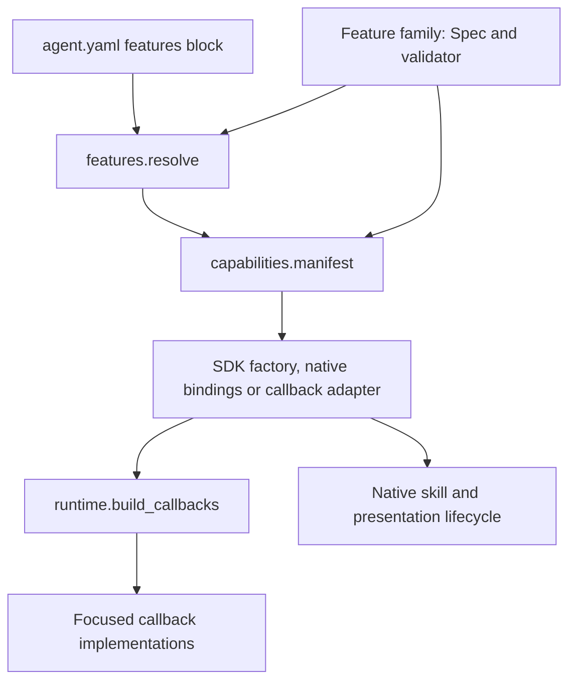

# Maintaining and extending features

Start with the feature family you want to change. Each family keeps its options,
validation, ordering constraints and support limits together. Shared pipeline
rules and callback assembly have separate, small entry points.

## Find the right file

**Python-only feature:** [Unified Capability Selection](capability-bindings.md)
uses `capability_bindings.py` for construction, `capability_contracts.py` for
public descriptors/protocols, `capability_retrieval.py` for shared shortlisting,
and `capability_policy.py` / `capability_execution.py` for policy and dispatch.
Native behavior is covered by `tests/runtime/test_capability_*.py`, including the
[runnable selection walkthrough](../examples/capability_selection.py). It has no
YAML `Spec`; do not add an inert feature flag to put it in the registry below.
Opt-in [background tasks](background-tasks.md) add `background_tasks.py` for the
queue/worker contract and `background_adk.py` for native launch/management/executor
adapters, with component and native `test_background_*` coverage. This path also
has no YAML, Console or generated-code export switch.

The remaining tables describe the configuration-driven feature families.

| Responsibility | Declarations and validation | Execution |
| --- | --- | --- |
| History, named context and exact replies | [conversation.py](../adkl/feature_definitions/conversation.py) | [History callbacks](../adkl/callbacks/history.py), [context callbacks](../adkl/callbacks/context.py), [tool-pair repair](../adkl/history.py) |
| Skill selection and typed skill context | [skills.py](../adkl/feature_definitions/skills.py) | [Retrieval](../adkl/retrieval.py), [native skill lifecycle](../adkl/skill_runtime.py) |
| Tool results and public-help attempts | [tools.py](../adkl/feature_definitions/tools.py) | [Tool callbacks](../adkl/callbacks/tools.py), [field projection](../adkl/projection.py) |
| Output cleanup, redaction and staged widgets | [presentation.py](../adkl/feature_definitions/presentation.py) | [Output filters](../adkl/output_filters.py), [contract callback](../adkl/callbacks/presentation.py), [presentation packs](../adkl/presentation.py) |

`analytics`, `semantic_cache` and `identity_gate` have been retired from the
selectable registry. Old configuration fails with explicit migration guidance.
See [native-host migration](native-host-migration.md) for deprecations and ownership.


## Follow a feature through the system



| Shared entry point | Owns |
| --- | --- |
| [features.py](../adkl/features.py) | Registry, defaults, activation, ordering checks and console descriptions |
| [feature_definitions/model.py](../adkl/feature_definitions/model.py) | `Spec`, `Kind`, `Stage` and `FeatureError` |
| [capabilities.py](../adkl/capabilities.py) | Preview/SDK/export reports and unsupported-feature rejection |
| [runtime.py](../adkl/runtime.py) | Callback assembly and the independent wiring inventory |
| [adapters.py](../adkl/adapters.py) | Composition with callbacks owned by an existing host agent |
| [bindings.py](../adkl/bindings.py) | Public native bindings and lifecycle phase placement shared with the project factory |
| [callbacks/_lifecycle.py](../adkl/callbacks/_lifecycle.py) | Internal callback normalization, replacement chains and emission/completion error handling |
| [agent_runtime.py](../adkl/agent_runtime.py) | Project-file native agent construction, skills and presentation |

Existing imports such as `from adkl.features import Spec, resolve` and
`from adkl.runtime import make_history_slicer` still work. Agent YAML keys,
default values and feature-card response fields are unchanged. Applications do
not need to import the internal family modules.

## Change an existing feature

1. Find its `Spec` in the family table above. Read the support detail and linked
   runtime behavior before changing an option.
2. Update its options and local validator together. Validators receive that
   feature's merged options and raise `FeatureError` for invalid configuration.
3. Change the callback or native lifecycle code that consumes the option.
4. Test the observable result and failure path. Update the user guide if the
   configuration or behavior changes.

Resolution validates declared options even when a feature is inactive. Each
resolved configuration owns copies of defaults and supplied options; editing one
agent must not change another agent or the console's defaults. Validators should
check values without mutating them or loading project/runtime dependencies.

## Add one incremental feature

Add a `Spec` to the relevant family's `SPECS` tuple. The registry loads those
tuples explicitly; there is no filesystem scan or dynamic plugin discovery.
For a new family, also add its module to the family list in `features.py`.

An illustrative declaration starts unsupported:

```python
def validate_reply_budget(config):
    value = config["max_chars"]
    if type(value) is not int or value < 1:
        raise FeatureError("reply_budget.max_chars must be a positive integer")


Spec(
    name="reply_budget",
    kind=Kind.AFTER_MODEL,
    summary="Apply a configured reply-length budget.",
    options={"max_chars": ("int", 2000, "Maximum reply characters.")},
    validate=validate_reply_budget,
    support_detail="Reply budgeting has no runtime callback yet.",
)
```

This example is not an available feature. A declaration provides authoring and
validation only; selecting an unsupported feature blocks SDK and preview use.

To make a new feature executable:

1. Implement the smallest callback or native ADK extension that owns the behavior.
   Reuse native ADK primitives and existing transformation helpers.
2. Wire it explicitly in `runtime.build_callbacks`, or in the native factory for
   lifecycle features. Add the feature to `runtime.IMPLEMENTED` after wiring it.
3. Set `support_status` to `implemented` or `partial`, with an accurate
   `support_detail`. The preview and SDK manifests read these fields; standalone
   export remains a separate contract in `capabilities.py`.
4. Set `callback_adapter=True` only if the feature works within the adapter's
   before-model, before-tool and after-tool contract. Keep factory-dependent
   skills, presentation and other hooks out of that adapter.
5. Test both factory execution and callback adoption when both are supported.
   Include inactive/disabled behavior, invalid options, errors and ordering risks.

Support metadata and the wiring inventory are checked independently. Passing that
check is not proof of behavior; native execution tests still need to exercise the
new path. Keep the support table below aligned with the registry.

## Support status

These are SDK/preview declarations, not production or business-outcome certification.
Generated-code export has a separate, more restrictive manifest.

| Feature | Status | Contract |
| --- | --- | --- |
| `skill_retrieval` | implemented | Native selection, pins, optional history/continuation and small-catalog bypass |
| `skill_state_injection` | implemented | Typed state for active skills |
| `history_slicing` | implemented | User-turn request window |
| `tool_history_repair` | implemented | Completed request-only tool-pair repair |
| `prompt_state_injection` | partial | Appends context, does not replace placeholders |
| `short_circuit` | implemented | Exact phrase native replies |
| `tool_result_projection` | implemented | Explicit application-declared field projection |
| `tool_result_trimming` | implemented | [Generic incomplete-result envelope](tool-results.md), not schema-specific reduction |
| `progressive_auth` | partial | Public-help marker, not authorization |
| `output_cleanup` | implemented | Aggregated response cleanup |
| `pii_redaction` | implemented | Configured output-pattern redaction, not comprehensive data protection |
| `staged_widgets` | implemented | Native staged delivery; host owns acknowledgement/retries |

## Preserve callback ordering

The pipeline declares activation and dependency constraints. ADK has distinct
hook phases, and `runtime.py` explicitly assembles each phase; the pipeline is
not a general-purpose callback scheduler.

For tool results, preserve this sequence:

**Observe the raw response → project fields → trim payload → append current
widget guidance.**

[compose_after_tool](../adkl/callbacks/composition.py) passes each replacement to
the next transform, including empty values. Errors propagate. The outer native
ADK chain has its own short-circuit semantics, so register the composed callback
once. Output cleanup and redaction similarly share one model-response callback.

Host tools retain responsibility for identity, authorization and consequential
actions. A public-help marker or a visible tool is not an authorization boundary.

## Verify the change

Use [development.md](development.md) for the required component and native suites.
Useful focused checks include:

```bash
uv run --no-sync python -m pytest \
  tests/test_features.py tests/test_feature_extension.py \
  tests/test_capabilities.py tests/test_runtime.py tests/test_adapters.py -q
```

Add native cases under `tests/runtime/` for actual callback, skill or presentation
behavior. Keep them synthetic and independent of customer repositories and model
credentials. When modules move, also build the wheel and check imports from the
wheel so a source-checkout test cannot hide a packaging failure.
